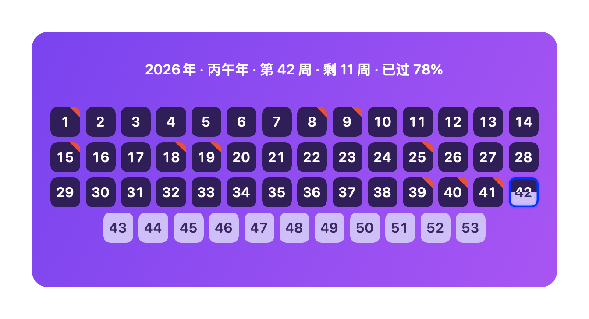
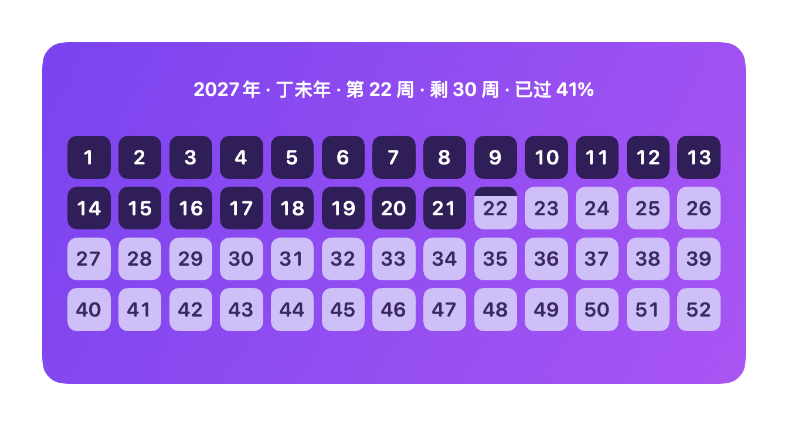
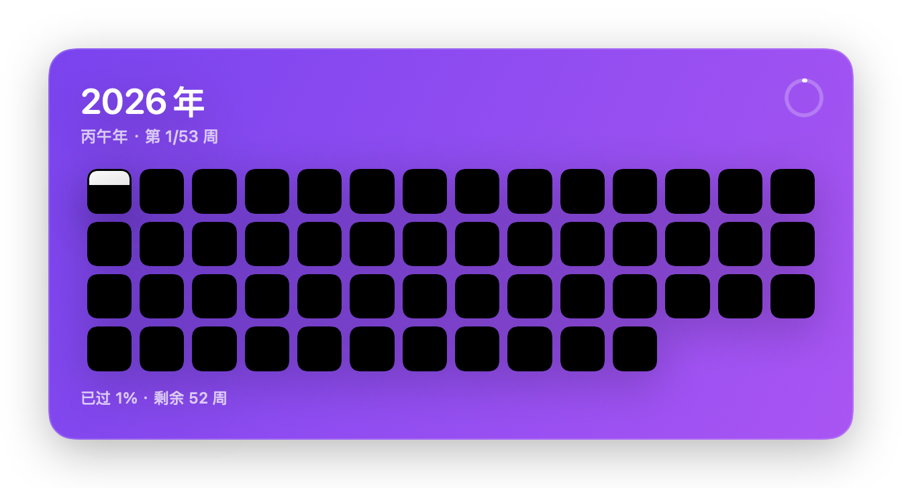
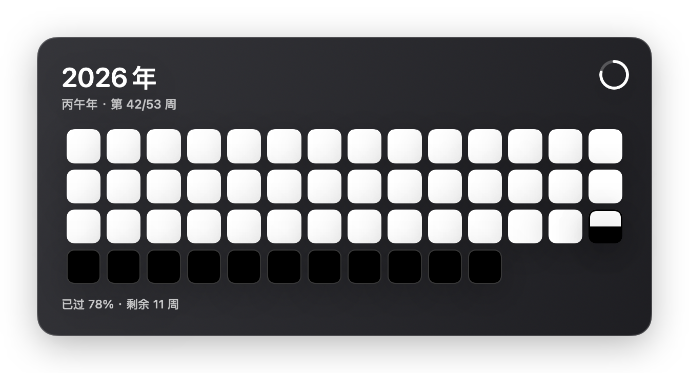
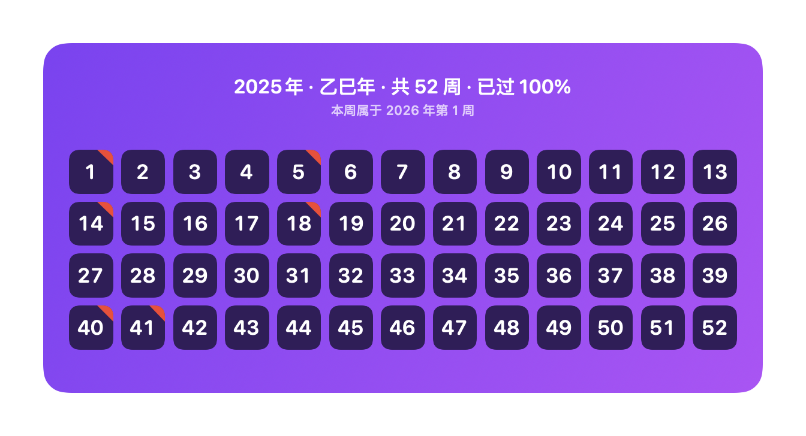
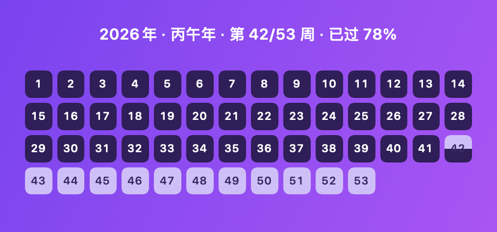
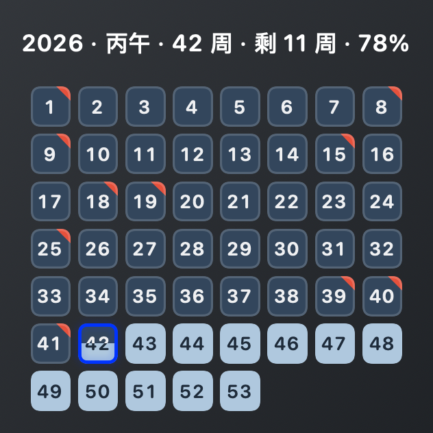

# 年进度小组件 · YearProgress

把「一年里的每一周」画成一格小方块：**已过的周是深色块，未来的周是浅色块，本周是浅底 + 从底部升起的深色进度条**。
顶部一行居中显示「2026年 · 丙午年 · 第 42/53 周 · 已过 78%」，下面是方块网格。

两种状态的颜色都和底色同色系、明度差接近：紫色主题是**深梅子 `#2F1E57` / 浅薰衣草 `#CFBFF8`**，
石墨主题是**深石板蓝 `#33465C` / 浅冰蓝 `#AFC8DE`**。
（用纯白/纯黑时，浅色在深底上会视觉「发胀」、深色会「收缩」，同尺寸看起来就是不一样大；
实测两者几何都是 38×38px，纯粹是错觉，所以改用对比更柔和的一对色。）



| 52 周的年份（13×4 方阵） | 年初（第 1 周） | 石墨主题 | 年末跨年周 |
|---|---|---|---|
|  |  |  |  |

系统小组件（medium / small）长这样：

| 通知中心 medium（338×158） | 通知中心 small（158×158） |
|---|---|
|  |  |

- 默认尺寸 **600×292**（比例 2.06，与参考图实测的 442×215 一致）。
- 默认 **13 列**：52 周的年份正好 4×13 方阵；**53 周的年份自动换列**，避免最后一行只剩一个孤块。
- 2026 年是 **53 周**（ISO 8601），2025 / 2027 是 52 周。

---

## 快速开始

```bash
make install    # 【推荐】打包 + 组装 .appex + 签名 + 安装到 /Applications 并注册给系统
make widget     # 同上，但只产出 build/YearProgress.app（不往 /Applications 拷）
make uninstall  # 从 /Applications 卸载（想彻底移除就再 make widget-uninstall）
make test       # 单元测试（17 个）
make preview    # 导出几个典型日期的 PNG 到 docs/
make app        # 只打包宿主 App（不含小组件扩展）
make run        # 前台直接跑（开发用）
make spec       # 重新生成 spec/year-weeks.json（跨平台真值表）
```

安装后「怎么用」：**点菜单栏最右侧的日期时间 → 通知中心底部「编辑小组件…」→ 搜索「年进度」→ 选尺寸 → 添加**。
（也可以在桌面右键 → 编辑小组件。）

宿主 App 本身只有一个说明窗口 + 菜单栏小图标（4×4 小方块，不占 Dock）：
菜单里可以打开可选的「桌面挂件」（贴桌面的浮窗版）、切换主题、尺寸、立即刷新，以及退出。

### 命令行参数

```bash
.build/debug/YearProgressMac --help
.build/debug/YearProgressMac --date 2026-12-31 --snapshot out.png --theme graphite --size 450x219 --scale 2
```

| 参数 | 说明 |
|---|---|
| `--snapshot <path>` | 离屏渲染成 PNG 后退出（无需窗口，用于自查/分享） |
| `--date <yyyy-MM-dd>` | 把「今天」固定成某一天，方便验证任意日期 |
| `--theme violet\|graphite` | 卡片配色，默认紫色 |
| `--size <W>x<H>` | 卡片尺寸，默认 600x292 |
| `--scale <n>` / `--margin <pt>` | 导出倍率（默认 2）与留白（默认 36，用于露出阴影） |
| `--timezone <id>` | 例如 `Asia/Shanghai` |
| `--week-start monday\|sunday\|locale` | 一周从哪天开始，默认周一（ISO 8601） |

---

## 系统小组件（WidgetKit 扩展）

真正的系统小组件是宿主 App 里的 `Contents/PlugIns/YearProgressWidget.appex`，`make widget` 会做四件事：

1. `swift build` 出扩展可执行文件（WidgetKit 代码在 CLT SDK 下可以编译，这一点已实测）；
2. 手工摆好 `.appex` 包结构 + `Support/Widget-Info.plist`（`NSExtensionPointIdentifier = com.apple.widgetkit-extension`）；
3. 用 `codesign --sign -` 给扩展附上 `com.apple.security.app-sandbox` 权限并逐层签名（扩展先签、宿主后签）；
4. `pluginkit -a` + `lsregister -f` 注册，再 `killall chronod` 让 WidgetKit 重新枚举。

> **入口点（踩过的坑）**：`.appex` 可执行文件必须链接成 `-e _NSExtensionMain`（Xcode 的 `LD_ENTRY_POINT`），
> 由扩展运行时接管后再回调 SwiftUI 的 `WidgetBundle.main()`。少了它，进程会直接跑 `WidgetBundle.main()`，
> `ExtensionFoundation` 初始化时 `MainActor.assumeIsolated` 断言失败 → `EXC_BREAKPOINT`，
> 表现就是"已经注册但小组件库里找不到"（`~/Library/Logs/DiagnosticReports/YearProgressWidget-*.ips`）。
> 现在写在 `Package.swift` 的 widget target `linkerSettings` 里；`make diagnose` 可一键体检。

已经实测到的结果（`pluginkit` / `chronod` 日志 / 沙盒容器三处互证）：

| 检查 | 结果 |
|---|---|
| `pluginkit -m -i com.local.yearprogress.widget` | ✅ 已登记，扩展点 `com.apple.widgetkit-extension` |
| `chronod` 日志 | ✅ `WidgetExtension - identifier: com.local.yearprogress::com.local.yearprogress.widget, isApple: false`，并为其建立了 `Descriptors[...]` 状态 |
| 沙盒容器 `~/Library/Containers/com.local.yearprogress.widget` | ✅ 已生成 → 说明扩展真的被系统拉起过（签名 + 沙盒 + 扩展点都通过了） |
| 扩展二进制依赖 | ✅ 只依赖系统框架（Foundation / SwiftUI / WidgetKit），无 Xcode 私有依赖 |

排错用的诊断日志（扩展被系统调用时写一行：预览 = `snapshot`、真正上桌面 = `timeline`）：

```bash
cat ~/Library/Containers/com.local.yearprogress.widget/Data/Library/Application\ Support/widget-activity.log
pluginkit -m -v -p com.apple.widgetkit-extension | grep -i yearprogress
```

`widget` 视图与 App 大卡片共用同一份实现（`YearProgressUI/YearProgressCardView.swift`），差异只有两点：
小组件档位字号有上下限（`CardProfile.widget`），以及去掉了 App 专属的圆角/描边/阴影和 tooltip
（圆角背板由系统提供，用 `.containerBackground(for: .widget)` 声明）。

## 规则约定（都写进了测试）

| 主题 | 约定 |
|---|---|
| 一年几周 | **ISO 8601**：周一为首日、第 1 周含 1 月 4 日 → 52 或 53 周。不自己推公式，用系统日历取值；同时用「1 月 1 日是周四，或闰年且 1 月 1 日是周三 → 53 周」的独立规则做**交叉校验**（1990–2060 逐年比对）。 |
| 年份 | **按当前公历年**：2025-12-30 显示「2025年 · 乙巳年」，不会被 ISO 周年度带到 2026。 |
| 跨年周 | 一年 52/53 周，但年初/年末会有 1–3 天落在「跨年周」里（如 12-29…12-31 属于次年 ISO 第 1 周；1 月 1–3 日属于上一年 ISO 的最后一周）。此时网格里没有「本周」，顶部会多一行小字写明「本周属于 2026 年第 1 周」，进度自然显示 100% 或 0%。逐日校验 2019–2031 × 4 个时区，且断言跨年窗口每月最多 3 天。 |
| 干支纪年 | 按公历年换算：2026 → **丙午年（马）**，2025 → 乙巳年。农历意义上的换年（春节/立春）未接入，如需精确到节气，改 `Ganzhi(year:)` 一处即可。 |
| 本周进度 | 从周一 00:00 起按 7 天线性折算，体现在方块从底部升起的深色比例上。 |
| 自动刷新 | 定时到下一个零点 + 系统跨天通知 + 睡眠唤醒 + 时区变更，都会重算。 |
| 配色 | 不用纯黑/纯白：与底色同色系的「深 + 浅」一对色，明度差左右对称，方块不会一大一小。紫色＝深梅子/浅薰衣草；石墨＝深石板蓝/浅冰蓝（石墨底上留 1px 半透明描边，避免深块与底色粘连）。 |

## 项目结构

```
Package.swift
Sources/
  YearProgressCore/          纯逻辑，不依赖任何 UI 框架（macOS/iOS 都能用）
    WeekStartMode.swift      一周从哪天开始
    YearWeekMath.swift       52/53 周、周区间、下一个零点
    YearProgress.swift       WeekCell / YearProgress / YearProgressCalculator
    Ganzhi.swift             天干地支生肖
    GridLayout.swift         列数、行数、方块边长、间距、每行几个
  YearProgressUI/           App 与小组件共用的视图层（SwiftUI）
    YearProgressCardView.swift 卡片视图（顶部单行 + 网格 + 方块），支持 app / widget 两种档位
    CardTheme.swift / CardMetrics.swift   配色与尺寸推导（含字号上下限）
  YearProgressWidget/        WidgetKit 扩展（TimelineProvider + Widget + WidgetBundle）
  YearProgressMac/           macOS 宿主 App（AppKit + SwiftUI）
    WelcomeWindow.swift       首启使用说明窗口
    AppState.swift            状态 + 零点刷新调度
    AppDelegate.swift         菜单栏图标与菜单、窗口层级
    WidgetPanel.swift         无边框、不抢焦点的面板
    Snapshot.swift            离屏渲染 PNG
    CLIOptions.swift / main.swift
  YearWeekSpecDump/          生成跨平台真值表
Tests/YearProgressCoreTests/ 17 个测试
Support/                     手写 Info.plist 与 entitlements（没有 Xcode，就自己摆包结构）
spec/year-weeks.json         Swift 与 Kotlin 共用的真值表（2015–2035 + 1029 个探针日期，含 ISO 周年度）
PLAN.md                      完整技术方案（含 iOS / Android 路线与里程碑）
```

---

## 本机环境说明（为什么不装 Xcode）

这台机器只有 CommandLineTools（macOS 27.0.1 / SDK 26.5），**没有 Xcode**，所以：

| 事项 | 结论 |
|---|---|
| 编译运行 macOS 版本 | ✅ 可以，`swift build` / `make app` 都走通（AppKit + SwiftUI 链接正常） |
| 离屏渲染 PNG 自查 | ✅ 可以，用 `ImageRenderer`，不需要窗口 |
| 单元测试 | ⚠️ XCTest 模块缺失，用 **Swift Testing**；CLT 里带了 `Testing.framework` 但不参与默认链接，Makefile 已封装 `-F / -framework / -rpath` 参数（有 Xcode 时会自动去掉这些参数） |
| 真·WidgetKit 小组件（.appex） | ✅ 已打通：手工组包 + ad-hoc 签名 + `pluginkit` 注册，`chronod` 已识别该 WidgetExtension（无 Xcode） |
| iOS | ❌ 本机没有 iOS SDK / 模拟器，无法编译，代码先就位（见 PLAN.md §7） |
| Android | ❌ 本机没有 Android SDK / Gradle，无法编译（见 PLAN.md §8） |

## 下一步（PLAN.md 里的里程碑）

- **M2** 打磨：把卡片放进「钉在桌面」的默认层级、更多主题、可选显示当前周百分比、锁屏/待机样式。
- **M3** 试真 WidgetKit 小组件：手工打 `.appex` + `pluginkit -a` 注册，成功即可加入系统小组件库；失败就保留当前形态（视觉一致）。
- **M4** iOS：`YearProgressCore` 直接复用，补 WidgetKit 扩展 + App Intents 配置 + 宿主 App（需要 Xcode 才能编译验证）。
- **M5** Android：Kotlin + Jetpack Glance，用 `spec/year-weeks.json` 做跨端一致性校验。
